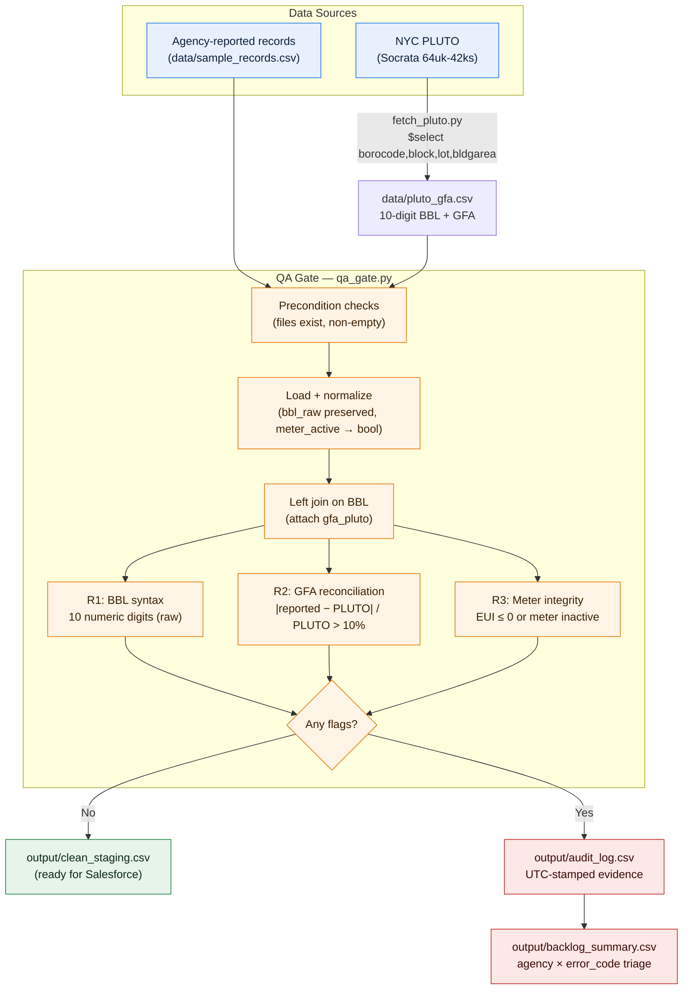

# NYC BBL QA Gate & Audit-Evidence Engine

A pre-commit validation pipeline that sits between agency-reported building data and downstream systems (Salesforce / BBL registry). Every record that fails a rule leaves an immutable, UTC-stamped audit record and a categorized remediation backlog entry.
## Architecture



## Business Context
This pipeline replicates the pre-commit validation logic a Compliance & Reporting Senior Program Manager would design at NYC DCAS DEM: before agency-reported building data enters the Salesforce/BBL registry, it must pass automated gates with retained audit evidence.

## Data Sources
| Source | Provider | Method |
|---|---|---|
| Agency-reported records | Simulated in `data/sample_records.csv` | Hand-crafted for rule coverage |
| **Authoritative GFA** | **NYC PLUTO** (Socrata `64uk-42ks`) | `scripts/fetch_pluto.py` calls the SODA API and writes `data/pluto_gfa.csv` |

## Rules
| ID | Condition | Error Code | Downstream Action |
|----|-----------|------------|-------------------|
| R1 | BBL ≠ 10 numeric digits (validated on raw value) | `ERR_BBL_SYNTAX` | Block + backlog |
| R2 | \|GFA_reported − GFA_PLUTO\| / GFA_PLUTO > 10% | `ERR_GFA_MISMATCH` | Block + backlog |
| R2b | BBL not found in PLUTO extract | `ERR_PLUTO_MISSING` | Block + backlog |
| R3 | EUI ≤ 0 OR `meter_active = False` | `ERR_METER_INACTIVE` | Block + backlog |

## Outputs
- `output/clean_staging.csv` — records ready for downstream ingestion
- `output/audit_log.csv` — immutable audit evidence with UTC timestamp
- `output/backlog_summary.csv` — root-cause triage by agency × error code

## Setup (macOS)
```bash
python3 -m venv .venv
source .venv/bin/activate
python3 -m pip install -r requirements.txt
python3 scripts/fetch_pluto.py     # pulls real PLUTO data from Socrata
python3 scripts/qa_gate.py         # runs the gate, writes output/