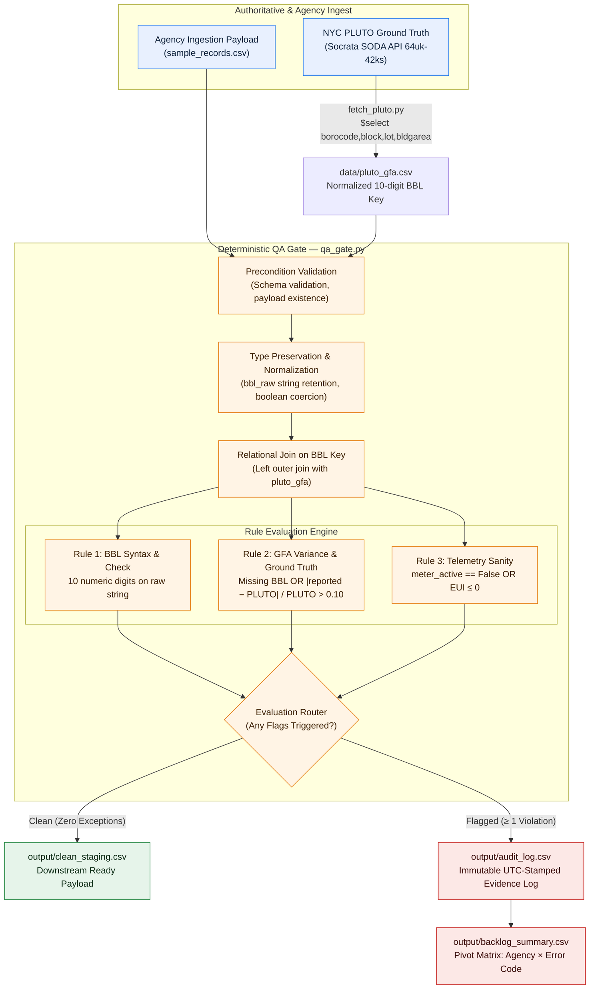

# NYC BBL Automated QA Gate & GRC Audit-Evidence Engine

An automated pre-commit ingestion gate, deterministic data verification pipeline, and audit logging framework. The engine validates agency-submitted building and energy telemetry against authoritative public municipal ground truth (NYC PLUTO via Socrata SODA API) before allowing downstream persistence, generating immutable audit artifacts for compliance triage and governance reporting.

---

## Summary &  Impact

Downstream operational registries (such as CRM/ERP instances or central registry databases) fail when unvalidated, self-reported data propagates silently into production schemas.

This engine implements strict **pre-commit gatekeeping and verification controls**:

* **Zero-Tolerance Semantic & Syntax Guardrails:** Enforces strict 10-digit borough-block-lot (BBL) identifiers on unparsed raw strings to prevent silent type coercion (e.g., dropping leading zeroes during float/int conversion).
* **Authoritative Baseline Cross-Reconciliation:** Pulls authoritative building footprints directly from NYC Open Data (PLUTO API) and executes vectorized variance checks ($\pm 10\%$ tolerance) against reported gross floor area (GFA).
* **Telemetry Integrity Controls:** Screens energy metrics to flag non-physical values ($EUI \le 0$) and decommissioned/inactive meters.
* **Deterministic Governance & Evidence Artifacts:** Divides ingest streams into clean production staging versus immutable, UTC-stamped audit logs broken down by agency and failure taxonomy.

---

## System Architecture



---

## Technical Mechanics: What the Code Executes

### 1. Ingestion & Ground-Truth Acquisition (`fetch_pluto.py`)

* Authenticates and queries NYC OpenData via Socrata SODA API (`64uk-42ks`).
* Extracts authoritative parcel attributes: `borocode`, `block`, `lot`, and `bldgarea`.
* Standardizes BBLs into an ISO/IEC 10-character composite key structure:

$$\text{BBL} = \text{Boro (1 digit)} + \text{Block (padded to 5 digits)} + \text{Lot (padded to 4 digits)}$$


* Caches normalized attributes to disk (`data/pluto_gfa.csv`) as an offline ground-truth lookup table.

### 2. Guardrail Enforcement & Execution (`qa_gate.py`)

The pipeline runs sequential vector checks across ingested records, evaluating each record against deterministic risk criteria:

| Rule Code | Validation Criteria | Mathematical / Logical Condition | Governance Risk Mitigated | Downstream Action |
|---|---|---|---|---|
| `ERR_BBL_SYNTAX` | Structural & Lexical Validity | `regex match: ^[0-9]{10}$` on unparsed string | Broken entity resolution, dropped leading zeroes, corrupt foreign keys. | Record rejected; isolated to audit trail. |
| `ERR_PLUTO_MISSING` | Ground Truth Existence | `gfa_pluto is NULL` | Phantom assets, unregistered parcels, fraudulent reporting. | Record rejected; isolated to audit trail. |
| `ERR_GFA_MISMATCH` | Physical Footprint Reconciliation | $\frac{\| \text{GFA}_{\text{reported}} - \text{GFA}_{\text{PLUTO}} \|}{\text{GFA}_{\text{PLUTO}}} > 0.10$ | Miscalculated emissions baselines, out-of-date building alterations. | Record rejected; isolated to audit trail. |
| `ERR_METER_INACTIVE` | Telemetry Validity & Active Status | `meter_active == False` OR $\text{EUI} \le 0$ | Skewed portfolio aggregates, zero-value division, inaccurate decarbonization benchmarks. | Record rejected; isolated to audit trail. |

### 3. Split-Stream Output & Audit Evidence Generation

The engine guarantees partition isolation between clean and non-compliant records:

* **Production-Safe Ingestion Target (`output/clean_staging.csv`):** Fully sanitized dataset guaranteed to meet relational schema constraints and reference tolerances. Safe for automated ingestion into downstream CRMs, ERPs, or data warehouses.
* **Non-Repudiation Audit Log (`output/audit_log.csv`):** Detailed exception records capturing input payload state, triggering error code, evaluated variance metrics, and UTC execution timestamps (`evaluated_at_utc`).
* **Governance Backlog Matrix (`output/backlog_summary.csv`):** An aggregated crosstab pivot (`reporting_agency` $\times$ `error_code`) providing immediate visibility into systemic agency-level data anomalies and root causes.

---

## Repository Structure

```
├── data/
│   ├── pluto_gfa.csv          # Authoritative reference dataset generated from PLUTO SODA API
│   └── sample_records.csv     # Raw ingested agency records (edge cases, anomalies, valid rows)
├── output/
│   ├── clean_staging.csv      # Verified, zero-defect records ready for downstream load
│   ├── audit_log.csv          # Granular evidence log of every flagged constraint
│   └── backlog_summary.csv    # Cross-tabulated triage matrix (Agency vs. Error Taxonomy)
├── scripts/
│   ├── fetch_pluto.py         # Socrata API extractor, BBL normalizer, and caching routine
│   └── qa_gate.py             # Rule engine, validation pipeline, and output router
├── requirements.txt
└── README.md

```

---

## Quickstart & Local Verification

### 1. Environment Initialization

```bash
python3 -m venv .venv
source .venv/bin/activate
pip install -r requirements.txt

```

### 2. Fetch Authoritative Ground Truth

```bash
# Pulls current PLUTO parcel and building area data from NYC Open Data SODA API
python3 scripts/fetch_pluto.py

```

### 3. Run the Verification Pipeline

```bash
# Processes records, applies rules, and partitions clean vs audit records
python3 scripts/qa_gate.py

```

### 4. Inspect Audit Outputs

```bash
# Review isolated non-compliant records
cat output/audit_log.csv

# Review agency-level failure triage summary
cat output/backlog_summary.csv

```
